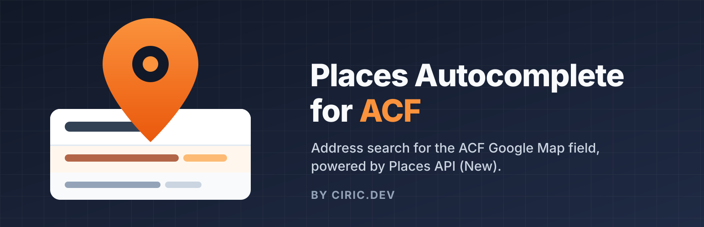
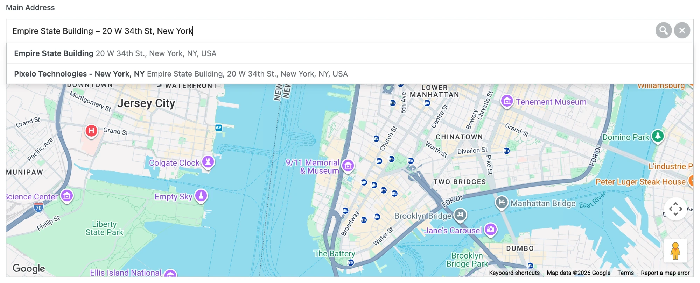
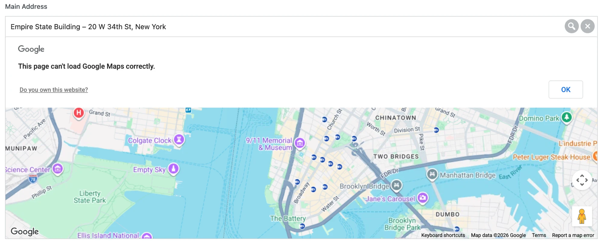

# Places Autocomplete for ACF

Fixes `LegacyApiNotActivatedMapError` in the [Advanced Custom Fields](https://www.advancedcustomfields.com/) Google Map field by switching its address search to Google **Places API (New)**.

**Available on WordPress.org:** [wordpress.org/plugins/places-autocomplete-for-acf](https://wordpress.org/plugins/places-autocomplete-for-acf/)



## The problem

The ACF Google Map field uses `google.maps.places.Autocomplete`, which belongs to Google's **legacy Places API**. Since March 1, 2025, Google no longer lets new Google Cloud projects enable the legacy Places API.

If your API key comes from a new project, the map loads, but as soon as you type an address nothing happens and the browser console shows:

```
You're calling a legacy API, which is not enabled for your project ...
LegacyApiNotActivatedMapError
```

ACF has not shipped a fix yet ([AdvancedCustomFields/acf#948](https://github.com/AdvancedCustomFields/acf/issues/948)).

## What this plugin does

- Stops ACF from loading the legacy Places library.
- Adds an address suggestions dropdown to the Google Map field, powered by Places API (New).
- Saves the selected place through ACF's own field methods, so the stored value (address, lat, lng, place_id, street, city, state, post code, country, …) keeps the same format as before.
- Works in wp-admin, in repeater and flexible content rows, and in front-end `acf_form()`.
- Keyboard navigation (arrow keys, Enter, Escape) and screen reader support (ARIA combobox/listbox).
- Uses Autocomplete session tokens, so each address search is billed as one session.
- Shows a clear message under the field when Google rejects a request (API not enabled, key restricted, domain not allowed, billing off), with a link to Google Cloud Console.

No settings page. Activate it and the field works.

## Screenshots

Address suggestions from Places API (New) in the ACF Google Map field:



Without this plugin, an API key from a new Google Cloud project shows "This page can't load Google Maps correctly" when you search for an address:



## Requirements

- WordPress 6.0+
- PHP 7.4+
- Advanced Custom Fields or ACF PRO
- A Google Maps API key (the one ACF already uses) with these APIs enabled:
  - Maps JavaScript API
  - Geocoding API
  - Places API (New)

## Installation

**From WordPress.org** (once published): Plugins → Add New → search for “Places Autocomplete for ACF”.

**From GitHub:** download the latest ZIP from [Releases](https://github.com/alexmeanpug/places-autocomplete-for-acf/releases), then upload it in Plugins → Add New → Upload Plugin.

Then, in Google Cloud Console, make sure the three APIs above are enabled for your key. If the key has *API restrictions*, add all three to the list.

## For developers

### PHP filter: `ciricdev_paacf_settings`

```php
add_filter( 'ciricdev_paacf_settings', function ( $settings ) {
	$settings['includedRegionCodes'] = array( 'us' ); // Up to 15 two-letter region codes.
	$settings['minChars']            = 3;             // Characters before suggestions are requested.
	$settings['debounce']            = 250;           // Delay in ms after typing stops.
	$settings['language']            = 'en';          // Default: site language.
	return $settings;
} );
```

### JS filter: `ciricdev_paacf_request`

Adjust the Places API (New) autocomplete request:

```js
acf.addFilter( 'ciricdev_paacf_request', function ( request, field, map ) {
	request.includedPrimaryTypes = [ 'street_address' ];
	return request;
} );
```

### JS action: `ciricdev_paacf_place_selected`

```js
acf.addAction( 'ciricdev_paacf_place_selected', function ( place, field, map ) {
	console.log( place.formattedAddress, place.location.toJSON() );
} );
```

## External services

The plugin sends the text typed into the ACF Google Map search box, the current map center, the site language and an anonymous session token to Google Maps Platform (Places API (New)). See the [Google Maps Platform Terms](https://cloud.google.com/maps-platform/terms) and [Google Privacy Policy](https://policies.google.com/privacy).

## Releasing

Pushing a tag (e.g. `1.0.1`) deploys the plugin to WordPress.org through GitHub Actions. Before tagging, bump the version in:

- `places-autocomplete-for-acf.php` (`Version:` header and `CIRICDEV_PAACF_VERSION`)
- `readme.txt` (`Stable tag:` and `== Changelog ==`)

Changes to `readme.txt` or `.wordpress-org/` on `main` update the WordPress.org page without a new release.

Required repository secrets: `SVN_USERNAME` and `SVN_PASSWORD` (your WordPress.org username and SVN password).

## Contributing

Bug reports and pull requests are welcome.

## License

[GPL-2.0-or-later](LICENSE)

Not affiliated with or endorsed by WP Engine (ACF) or Google.
